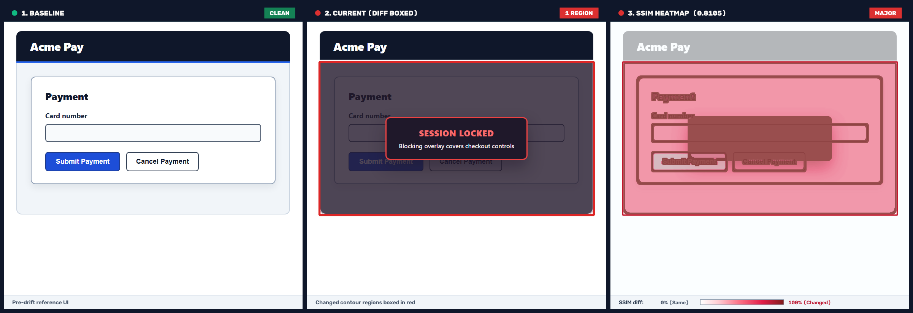
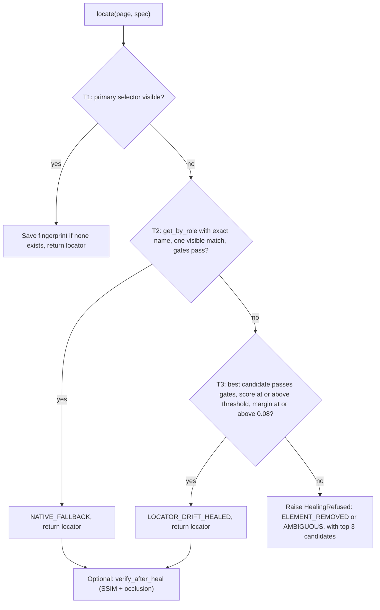

# Self-Healing Playwright Engine

[](https://github.com/Roza212/self-healing-playwright-engine/actions/workflows/test.yml)


**A self-healing locator engine for Playwright (Python) that recovers from UI drift, and refuses to guess when an element is genuinely gone.**

When a selector breaks, most "self-healing" tools pick the closest-looking element and keep going. That can turn a failing test into a passing one that clicks the wrong button. This engine heals only when a candidate clears a set of hard safety gates and a confidence threshold. Otherwise it fails the test and shows you the top candidates it rejected.

- **Three tiers, cheapest first.** Primary selector, then exact ARIA role and name, then multi-signal scoring with a local MiniLM model.
- **Hard safety gates.** Hidden, disabled, wrong-role, opposite-action (Submit vs Cancel) and moved-too-far candidates are rejected before scoring counts.
- **Post-heal visual check.** An SSIM diff and an occlusion test catch layouts that changed or elements that are covered.
- **Audit trail.** Every heal and refusal is written to JSONL, summarized in Markdown, and can fail CI when heals exceed a budget.
- **Local and free.** No LLM or paid API calls. The engine makes no network requests of its own; the MiniLM model is downloaded once and cached.



_Visual gate output for a covered checkout form (`SSIM = 0.8105`, `MAJOR`). Left: baseline. Centre: current page with changed regions boxed in red. Right: rose-to-crimson SSIM difference map over the baseline wireframe._

## Contents

- [How it works](#how-it-works)
- [Results](#results)
- [Quick start](#quick-start)
- [Usage](#usage)
- [Audit log and heal budget](#audit-log-and-heal-budget)
- [Project structure](#project-structure)
- [Testing and CI](#testing-and-ci)
- [Limitations](#limitations)
- [What this does not do](#what-this-does-not-do)

## How it works

Every page-object action calls `healer.locate(page, spec)`. The tiers run in order and stop at the first success. The ML tier runs only when both cheaper tiers fail.



| Tier       | What it does                                                                                                                                        | Accepts only if                                                                                       | Event class                     |
| ---------- | --------------------------------------------------------------------------------------------------------------------------------------------------- | ----------------------------------------------------------------------------------------------------- | ------------------------------- |
| **T1**     | Waits for the primary selector to be visible. On first success, stores a fingerprint (role, accessible name, text, bounding box, attribute tokens). | The primary selector resolves within `probe_timeout_ms`.                                              | none                            |
| **T2**     | `page.get_by_role(role, name=..., exact=True)`.                                                                                                     | Exactly one visible match that passes the hard gates.                                                 | `NATIVE_FALLBACK`               |
| **T3**     | Extracts all interactive elements in one `page.evaluate` call and scores each one.                                                                  | Passes hard gates, total score meets the threshold, and the lead over the runner-up meets the margin. | `LOCATOR_DRIFT_HEALED`          |
| **Refuse** | Raises `HealingRefused` (an `AssertionError`) carrying the top 3 candidates.                                                                        | No candidate qualifies, or two are too close.                                                         | `ELEMENT_REMOVED` / `AMBIGUOUS` |

### Hard gates (applied in T2 and T3)

| Gate                  | Rejects a candidate when                                                                                                                                                                                          |
| --------------------- | ----------------------------------------------------------------------------------------------------------------------------------------------------------------------------------------------------------------- |
| `hidden` / `disabled` | It is not visible or not enabled.                                                                                                                                                                                 |
| `role_mismatch`       | Its role is incompatible (a button may heal to a link, never to a textbox).                                                                                                                                       |
| `opposite_action`     | Its words sit in the same antonym group as the wanted words but share none (submit/cancel, add/remove, pay/refund, login/logout, and others). Embeddings rate these pairs as similar, so this is a lexical guard. |
| `moved_far`           | A fingerprint exists and the spatial score is below `0.10`.                                                                                                                                                       |

### T3 scoring

The total is a weighted average of four signals, renormalised over the signals that exist (spatial and attribute scores need a fingerprint).

| Signal     | Weight | Source                                                                              |
| ---------- | ------ | ----------------------------------------------------------------------------------- |
| Semantic   | 0.55   | Cosine similarity from `all-MiniLM-L6-v2`                                           |
| Role       | 0.15   | ARIA role compatibility                                                             |
| Spatial    | 0.20   | Gaussian falloff on centre distance, normalised by viewport                         |
| Attributes | 0.10   | Jaccard overlap of `id`, `name`, `class`, `data-test`, `data-testid`, `type` tokens |

| Setting                                       | Default                              |
| --------------------------------------------- | ------------------------------------ |
| `accept`                                      | 0.70                                 |
| `accept_high_risk` (specs with `risk="high"`) | 0.85                                 |
| `min_margin` (best minus runner-up)           | 0.08                                 |
| `min_spatial`                                 | 0.10                                 |
| `probe_timeout_ms`                            | 3000 (tests use 400 for local pages) |

Use `risk="high"` for payment, delete and other destructive controls. The mock benchmark uses normal risk so its drift cases can heal at 0.70.

### Post-heal visual gate

`verify_after_heal(page, healer, baseline_png, name)` compares a full-page screenshot against a baseline you captured before the drift, then checks whether the healed element is covered (`document.elementFromPoint` at its centre).

| Severity | Condition                                         | Result                                         |
| -------- | ------------------------------------------------- | ---------------------------------------------- |
| `NONE`   | SSIM at or above `0.985` and no changed regions   | Pass                                           |
| `MINOR`  | SSIM below `0.985`, or any changed region         | Pass (a reworded label is a legitimate change) |
| `MAJOR`  | SSIM below `0.95`, or the screenshot sizes differ | Fail                                           |

The gate also fails if the healed element is occluded. It is an explicit call: `locate()` does not invoke it, so you decide where to use it. SSIM is used instead of a raw pixel diff because it tolerates rendering noise: a unit test adds ±1 noise so that over half of the pixels differ, and SSIM stays above 0.97.

## Results

Seeded synthetic benchmark, `python -m benchmarks.run_benchmark --n 60 --seed 99`. Each case learns a fingerprint on a baseline checkout page, then loads a randomly mutated version (new id, new class, reworded label, deeper wrapping, reordered siblings, `<button>` changed to `<a role="button">`).

| Metric                           | Healing on           | Healing off |
| -------------------------------- | -------------------- | ----------- |
| Drift cases                      | 60                   | 60          |
| Heal success rate                | **91.67%** (55 / 60) | 0.00%       |
| Wrong heals                      | **0**                | n/a         |
| False refusals                   | 5                    | n/a         |
| Broken locators                  | 0                    | 60          |
| False heals on negative controls | **0** (of 2)         | 0           |
| Tier split of correct heals      | T2: 41, T3: 14       | n/a         |
| Median heal latency              | 321.13 ms            | n/a         |
| p95 heal latency                 | 331.21 ms            | n/a         |

**Reading these numbers honestly**

- Heal latency includes the 300 ms Tier 1 probe timeout, so most of it is waiting, not scoring.
- Most heals (41 of 55) were handled by the cheap T2 tier. T3 is reached only when T2's exact name match fails, which in this benchmark means the label was reworded; it handled 14 cases.
- The 5 false refusals were heavy rewordings: "Place Order" (2 cases) and "Complete Purchase" (3 cases). 4 of the 5 also changed the tag to `<a>`. The engine refused rather than guess, and no thresholds were tuned to fix it.
- "0 false heals" is measured on only 2 negative controls (a removed button, and a removed button with a far-away decoy named "Submit Payment (demo)"). Treat it as a sanity check, not a statistical claim.
- The benchmark uses one synthetic page. See [Limitations](#limitations).

The 8-case deterministic mutation suite in `tests/test_mutations.py` (6 must heal, 2 must refuse) runs the same engine plus the visual gate on every CI build.

## Quick start

**Requirements:** Python 3.11+. The first run downloads the MiniLM model (about 90 MB) from Hugging Face and caches it.

```bash
git clone https://github.com/Roza212/self-healing-playwright-engine.git
cd self-healing-playwright-engine

python -m venv .venv
source .venv/bin/activate          # Windows: .venv\Scripts\activate

pip install torch --index-url https://download.pytorch.org/whl/cpu   # CPU build keeps the install small
pip install -r requirements.txt
playwright install chromium        # on Linux CI: playwright install --with-deps chromium
```

Run the checks:

```bash
ruff check .
pytest -m "not live" -q            # unit, mutation bench, visual, audit (offline)
pytest -m heal -q --heal off       # control run: the 6 drift cases should now fail

python -m benchmarks.run_benchmark --n 60 --seed 99                # healing on
python -m benchmarks.run_benchmark --n 60 --seed 99 --heal off     # healing off
```

Benchmark output is written to `reports/benchmark.json` and `reports/benchmark.md`, and `pytest` writes a self-contained HTML report with heal telemetry and embedded visual diffs to `reports/report.html` (when `pytest-html` is installed). Optional live tests against [SauceDemo](https://www.saucedemo.com/) run with `pytest -m live -q`.

## Usage

**1. Describe elements once, in a page object.** Tests never contain selectors.

```python
from core.models import ElementSpec
from pages.base_page import BasePage


class CheckoutPage(BasePage):
    url = "https://shop.example.com/checkout"

    CARD = ElementSpec("checkout.card", "#card", role="textbox", accessible_name="Card number")
    PAY = ElementSpec(
        "checkout.pay",
        'button#submit-payment:has-text("Submit Payment")',  # primary selector
        role="button",
        accessible_name="Submit Payment",
        risk="high",  # stricter threshold (0.85) for destructive actions
    )

    def pay(self, card_number: str) -> None:
        self.fill(self.CARD, card_number)
        self.click(self.PAY)
```

**2. Hand the page object a healer.** `BasePage.el()` routes through `healer.locate()` when one is provided and falls back to a plain `page.locator()` when it is not.

```python
from core.audit import AuditLog
from core.config import HealConfig
from core.embedder import Embedder
from core.healer import SelfHealingLocator

cfg = HealConfig()                                   # defaults match the table above
healer = SelfHealingLocator(
    cfg,
    Embedder(cfg.model_name),                        # share one embedder across tests
    audit=AuditLog("reports/heal_events"),
    test_id="test_checkout",
)
CheckoutPage(page, healer).open().pay("4242 4242 4242 4242")
```

`tests/conftest.py` already provides this as a `healer` pytest fixture, including the `--heal on|off` switch.

**3. (Optional) Verify the page after a heal.**

```python
from core.vision_diff import shoot
from core.visual_gate import verify_after_heal

baseline = shoot(page)              # capture while the page is in its known-good state
# ... page drifts, a locator heals ...
verify_after_heal(page, healer, baseline, "checkout_pay")  # raises AssertionError on MAJOR change or occlusion
```

**4. Handle refusals.** `HealingRefused` is an `AssertionError`, so it fails the test normally. It exposes `failure_class` (`ELEMENT_REMOVED` or `AMBIGUOUS`) and `top`, the three best candidates with their scores and rejection reasons.

## Audit log and heal budget

Each heal and refusal is appended as one JSON line to `reports/<dir>/events_<pid>.jsonl` with the test id, logical name, failure class, tier, old and new selector, per-signal scores, runner-up, margin and URL. A visual result is attached when `verify_after_heal` runs.

```bash
python -m core.audit --dir reports/heal_events --budget 3
```

The command writes a Markdown table to `reports/heal_summary.md`, prints counts per failure class, and **exits 1 if `NATIVE_FALLBACK` + `LOCATOR_DRIFT_HEALED` exceeds the budget**. In a real suite every heal is drift someone should review, so the budget turns silent healing into a visible, reviewable number.

The `healer` fixture writes bench and visual test events to `reports/bench_events` and everything else to `reports/heal_events`. The bench heals on purpose, so only `heal_events` is subject to the budget. In this repository the budget check on `heal_events` is therefore trivially green; it becomes meaningful once you point real end-to-end tests at the same fixture.

## Project structure

```text
core/
  models.py          ElementSpec, Candidate
  config.py          HealConfig: thresholds, weights, timeouts
  embedder.py        lazy-loaded all-MiniLM-L6-v2 with in-memory cache
  scoring.py         pure scoring functions and hard gates (no browser, no model)
  dom_extractor.py   single-call JS extraction of interactive elements
  healer.py          SelfHealingLocator, HealingRefused
  vision_diff.py     SSIM, contour boxes, 3-panel diff PNG, occlusion check
  visual_gate.py     verify_after_heal()
  audit.py           JSONL log, Markdown summary, heal-budget CLI
  report_ui.py       pytest-html styling, KPI summary and inline visual diff cards
pages/               BasePage, SauceDemo and mock checkout page objects
mockbench/           offline checkout page with 6 drift and 2 negative mutations
benchmarks/          seeded benchmark runner
tests/               unit, heal, visual and live suites
docs/                SPEC.md and images
.github/workflows/   CI pipeline
```

## Testing and CI

| Marker   | Suite                                                    | Needs                |
| -------- | -------------------------------------------------------- | -------------------- |
| `unit`   | Scoring, gates and audit log                             | No browser, no model |
| `heal`   | 6 drift cases must heal, 2 negative controls must refuse | Chromium, MiniLM     |
| `visual` | SSIM, overlay and occlusion detection, heal-then-verify  | Chromium             |
| `live`   | SauceDemo login flows                                    | Internet             |

GitHub Actions runs on every push to `main`, every pull request and on manual dispatch: ruff, the offline suite, the heal-budget gate, a 40-case benchmark with seed 99, and uploads `reports/` as an artifact. The MiniLM model is cached between runs. `ruff` also bans `time.sleep` (rule `TID251`), so tests must use Playwright's auto-waiting.

## Limitations

- **English only.** The embedding model and the opposite-action word lists are English.
- **No Shadow DOM or iframes.** Candidate extraction reads the top-level document only.
- **One synthetic benchmark page.** Results show the mechanism works, not how it performs on your application.
- **Moved-far elements refuse by design.** An element that moves across the page fails the test instead of healing. That is the safe failure mode.
- **Heavy rewordings can refuse.** See the false refusals under [Results](#results).
- **The visual gate is opt-in** and needs a baseline screenshot taken on the same OS and fonts as the run being checked.

## What this does not do

- **No assertion healing.** Healing changes which element is found, never what a test asserts.
- **No auto-commit of new selectors.** Healed selectors go to the audit log and are checked against the CI budget, so a person decides whether to update the page object.
- **No page modification.** The healer is read-only.

<!-- Add a LICENSE file and a License section here. -->
